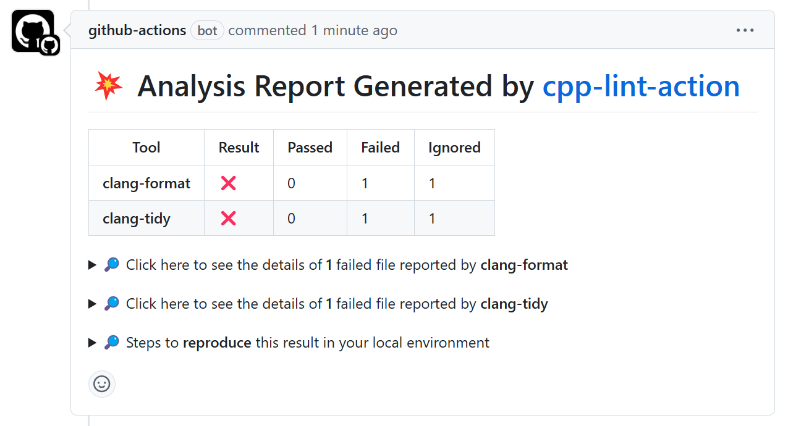

# cpp-lint-action


[](https://codecov.io/gh/emmett2020/cpp-lint-action)


cpp-lint-action is a tool used to check C++ code quality in Github workflow. It
relies on several code static analysis tools, supports multiple platforms, and
presents the results in various forms.

cpp-lint-action supports several C++ static code analysis tools. Currently, it supports [clang-format](https://github.com/llvm/llvm-project/tree/main/clang/tools/clang-format) and [clang-tidy](https://github.com/llvm/llvm-project/tree/main/clang-tools-extra/clang-tidy), and future versions will support cpplint and cppcheck. Both clang-format and clang-tidy have been verified to work on the Ubuntu versions currently supported by GitHub, so you can use them with confidence. You can find detailed supported platform and tools in [here](./docs/supports.md).

cpp-lint-action also presents the results in various forms. You can find all forms in [here](./docs/result_report.md).

**Welcome** to submit PRs, open issues, and provide usage feedback in the issues.

# Get started
Use cpp-lint-action on Github workflow is a easy thing.

Just add follow lines to your `.github/workflows/your_workflow_name.yml`
```yaml
on:
  pull_request:

permissions:
  contents: read
  issues: write
  pull-requests: write

jobs:
  cpp-lint:
    runs-on: ubuntu-24.04
    steps:
      - uses: actions/checkout@v4
      - uses: emmett2020/cpp-lint-action@v1
        env:
          GITHUB_TOKEN: ${{ secrets.GITHUB_TOKEN }}
        with:
          jobs: "2"
          max-review-comments: "50"
```

After the workflow is complete, you can see the following results displayed in the GitHub pull request review page.


By default, cpp-lint-action uses `clang-format-22` and `clang-tidy-22`. Pull request API reporting is only attempted for `pull_request` and `pull_request_target` events. On push, schedule, and other non-PR events, issue comments and pull request reviews are skipped automatically and `GITHUB_TOKEN` is not required for that reporting path.

You can find all inputs in [action.yml](action.yml). The most commonly adjusted options are:

| input | default | description |
| ----- | ------- | ----------- |
| `jobs` | `1` | Maximum file checks each enabled tool can run in parallel. |
| `max-review-comments` | `50` | Maximum inline pull request review comments to send. |
| `enable-comment-on-issue` | `true` | Create or update the summary issue comment on PRs. |
| `enable-pull-request-review` | `false` | Create inline pull request review comments on PRs. |
| `clang-format-version` | `22` | clang-format major version to find from `PATH`. |
| `clang-tidy-version` | `22` | clang-tidy major version to find from `PATH`. |

# Develop cpp-lint-action
1. cpp-lint-action needs c++20 standard. Ensure your local compiler version supports it.
2. cpp-lint-action now supports Ubuntu only.
3. cpp-lint-action uses Catch2 for unit tests. Run the Catch2 test binary directly.
4. cpp-lint-action has two system dependencies. You should install them before compilation.
```bash
sudo apt install -y libboost-all-dev libgit2-dev ninja-build
```

5. Download this repository and build.
```bash
git clone https://github.com/emmett2020/cpp-lint-action.git
cmake -S cpp-lint-action -B cpp-lint-action/build -GNinja
cmake --build cpp-lint-action/build -j`nproc`
```

6. Run unit tests.
```bash
./cpp-lint-action/build/tests/test
```

# How to use cpp-lint-action locally
Since cpp-lint-action is used for Github, you must set some environment variables to simulate Github CI environment.
```bash
export GITHUB_REPOSITORY="owner/repository"
export GITHUB_EVENT_NAME=pull_request
export GITHUB_WORKSPACE="/path/to/your/local/repo"
export GITHUB_REF="refs/pull/NUMBER/merge"
export GITHUB_SHA="test_branch_name_in_your_local_repository"
export GITHUB_EVENT_PATH="/path/to/event.json"
export GITHUB_TOKEN="your_private_github_token" # only required for PR API reporting

```

Then, just run cpp-lint-action
```bash
./build/cpp-lint-action --target-revision=main
```
